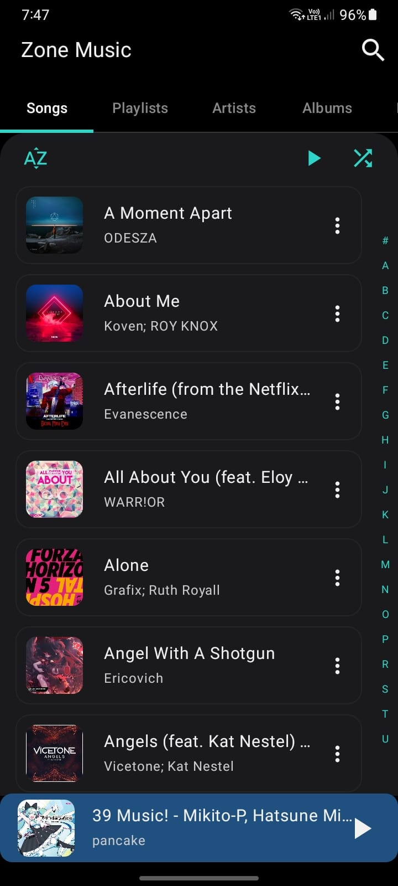
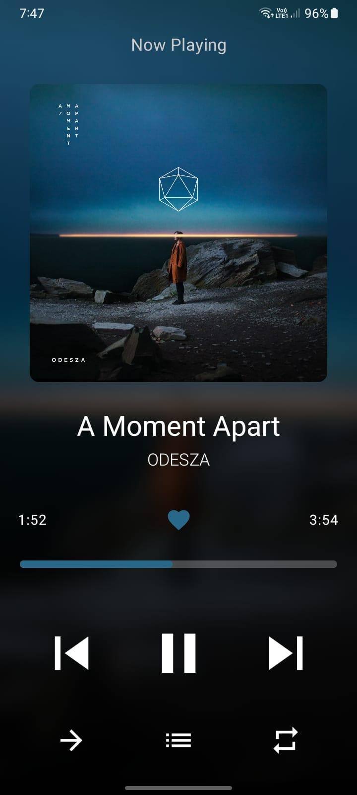

# Zone Music

A local-first music player for Android, built with Jetpack Compose and Media3 (ExoPlayer). Pick the folders your music lives in and Zone scans them, reads the tags and plays everything with a clean, gesture-driven player.

> **Status:** Stable (v1.0.0). The first stable release is out! Local playback, background playback, session restore, playlists, queue management and Android Auto browsing and playback are available. Google Drive music streaming is the only remaining planned major feature (see the [Roadmap](#roadmap)).

## Screenshots

<table>
  <tr>
    <td align="center"></td>
    <td width="60"></td>
    <td align="center"></td>
  </tr>
</table>

## Features

### Library

- **Folder-based library:** Choose one or more folders with the system folder picker (Storage Access Framework), so no broad storage permission is needed.
- **Fast scanning:** Folders are listed with `DocumentsContract` queries instead of per-file calls, which keeps big libraries quick.
- **Background refresh:** The library rescans when the app returns to the foreground (throttled), picks up new songs, and drops deleted ones.
- **Incremental tag reading:** Tags are only read for new files, in small batches on a limited thread pool, and saved to a JSON cache as it goes.
- **Instant start:** The cached library is shown immediately, then refreshed in the background.
- **Alphabetical order:** Songs are sorted by title using a locale-aware collator.
- **Album art thumbnails:** Loaded lazily for visible rows, with a memory cache and a disk cache.
- **Search:** Find songs in your local library.
- **Playlists:** Create and manage playlists, including Liked Songs.
- **Library organization:** Browse songs, artists, albums and folders.

### Player

- **Now Playing screen** with a blurred album-art background and colours taken from the artwork.
- **Swipe the album art** left or right to change tracks. The neighbouring covers slide in as you drag.
- **Pull down to dismiss:** The player is an overlay that follows your finger and reveals the library underneath.
- **Queue sheet** showing the playlist the engine is using, with the current song highlighted. Tap a row to jump to it.
- **Shuffle** that keeps the current song first and shuffles the rest, and the queue shows the real play order.
- **Repeat modes:** Off, one, all.
- **Seek bar**, play/pause, previous (restarts the song after 3 seconds) and next.
- **Press feedback** on buttons and rows.
- **Mini player pill** on the home screen.
- **Queue management:** Reorder, remove and play songs next.
- **Song options:** Add songs to playlists, manage the queue and delete songs.

### Background playback

- **Keeps playing when the app is closed**, through a `MediaLibraryService` backed by a `MediaSession`.
- **Notification controls** for play/pause, previous and next. Tapping the notification opens the app.
- **Session restore:** The queue, current song, shuffle and repeat state are saved and restored on the next launch.
- **Playback position restore:** Remembers where playback stopped and restores the position on the next launch.
- **Audio handling:** Pauses when headphones are unplugged and respects audio focus.

### Android Auto

- **Browse your library** from the car display with Songs, Folders, Artists and Albums.
- **Tap a song to play:** The whole library is queued starting from that song, and the phone's queue and now-playing UI follow along.
- **Search:** Search the music library from Android Auto.
- **Now-playing screen and controls** supplied by Android Auto from the player's metadata and state.
- **Playback controls:** Shuffle and repeat support.
- **Session persistence:** Playback state is saved while using Android Auto, including when the app is closed.
- **Voice commands:** Supports compatible Android Auto voice-search interactions.
- Tested in a car.

## Tech stack

| Area | Library |
|---|---|
| UI | Jetpack Compose, Material 3 |
| Playback | Media3 / ExoPlayer |
| Background playback and Android Auto | Media3 Session (`MediaLibraryService`) |
| Settings | Jetpack DataStore (Preferences) |
| Colours from artwork | AndroidX Palette |
| File access | Storage Access Framework, `DocumentsContract` |
| Concurrency | Kotlin Coroutines |

## Project structure

```text
app/src/main/java/com/zone/
├── ZoneApp.kt             Application class; owns the MusicEngine so it outlives the activity
├── MainActivity.kt        Hosts the home screen and the player overlay
├── HomeScreen.kt          Library list, mini player pill, thumbnail loading, session save/restore
├── PlayerScreen.kt        Now Playing UI, art carousel, queue sheet
├── MusicEngine.kt         ExoPlayer wrapper that exposes Compose state
├── PlaybackService.kt     MediaLibraryService: notification, background playback, Android Auto browse tree
├── SongScanner.kt         Folder scanning and tag reading
├── SongCache.kt           JSON cache of scanned songs
└── AppSettings.kt         DataStore-backed settings (folders, queue, last played, ...)
```

## Getting started

1. Clone the repository.

   ```bash
   git clone https://github.com/kashinathRemeshkumar/Zone-Music.git
   ```

2. Open it in Android Studio.
3. Let Gradle sync, then run the `app` configuration on a device or emulator.
4. Allow notifications when asked (Android 13+), so the playback controls can show.
5. Tap **Click to add folder** on the home screen and choose a folder that contains music.

## Roadmap

### Google Drive streaming (planned)

Stream music straight from Google Drive without downloading it first.

- [ ] Sign in with Google and request read-only Drive access.
- [ ] Choose Drive folders as library sources, next to local folders.
- [ ] List and scan audio files in Drive folders.
- [ ] Stream through ExoPlayer with authorised requests.
- [ ] Read tags and artwork for remote files, and cache the metadata.
- [ ] Optional offline caching of played songs.
- [ ] Handle token refresh, offline mode and network errors.

## Contributing

This is a personal project, but issues and suggestions are welcome.

## License

Licensed under the [Apache License, Version 2.0](LICENSE).

```text
Copyright 2026 Kashinath Remeshkumar

Licensed under the Apache License, Version 2.0 (the "License");
you may not use this file except in compliance with the License.
You may obtain a copy of the License at

    http://www.apache.org/licenses/LICENSE-2.0

Unless required by applicable law or agreed to in writing, software
distributed under the License is distributed on an "AS IS" BASIS,
WITHOUT WARRANTIES OR CONDITIONS OF ANY KIND, either express or implied.
See the License for the specific language governing permissions and
limitations under the License.
```
